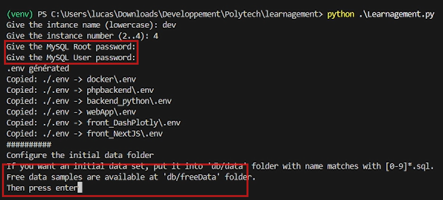
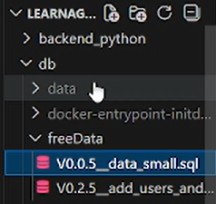
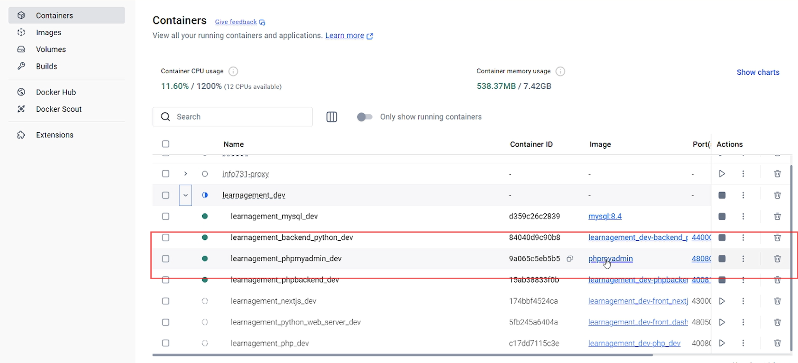
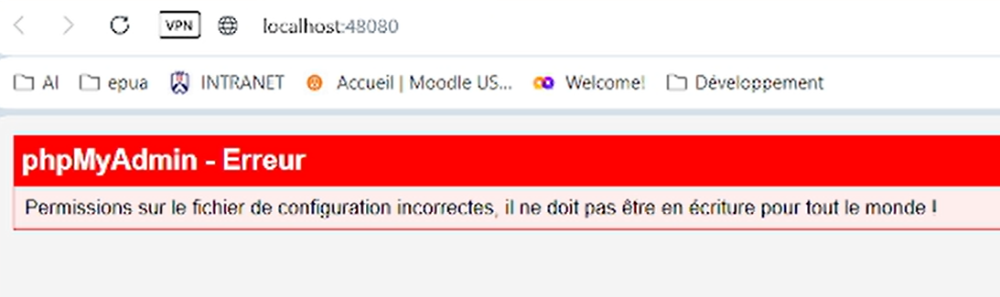
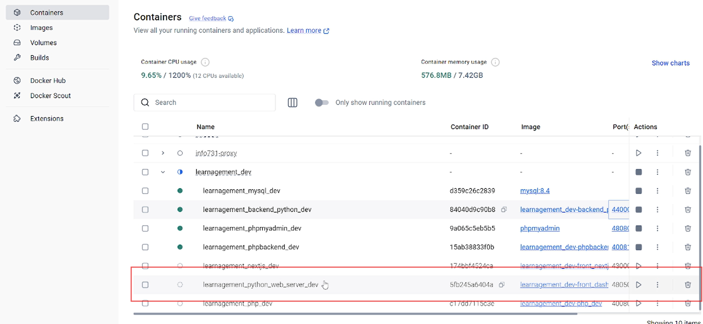

# **Installation Guide**

## **Prerequisites**

Avant le premier lancement de l'application, assurez-vous que tout les fichiers en '.sh' sont bien sous format 'LF' (Linux) et pas 'CRLF' (Windows).

## **Installation**

### Installer uv

Suivre le [guide d'installation de uv](https://docs.astral.sh/uv/getting-started/installation/). Il faut Python 3.12 ou supérieur.

### Lancement de l'application

`uv run` crée l'environnement et installe les dépendances au premier lancement.

```bash
uv run python Learnagement.py
```

### **Configuration de la base de données**


Lors du lancement de l'application veillez à :

- Nommer votre instance ( ici dev )
- Entrer un mot de passe Root pour la BDD ( ici toto )
- Entrer un mot de passe pour le User de la BDD ( ici toto )
- Lorsque le ligne Then press enter apparait, copier et coller le fichier ```.\db\freeData\V0.0.5__data_small.```sql  dans le dossier ```.\db\data\``` puis appuyer sur "Enter" pour continuer le lancement de l'application.
  

- Docker :
  
  - Cliquer sur le Port utilisé par la phpmyadmin pour vérifier sont foncitonnement
  - Dans le cas d'une erreure tels que :
    
    Aller dans le terminal ( Exec ) du container et tapper la commande :

    ```bash
    chmod 755 /etc/phpmyadmin/config.inc.php
    ```
  - Arreter l'application ( CTRL + C )
  - Utiliser la commande dans le terminal du programme :

    ```bash
    docker compose up
    ```
  - Redémarrer le container puis essayer de se connecter à phpmyadmin pour vérifier sont foncitonnement
     Username : learnagement
     Password : ( ici toto )
  - Verifier que le container suivant et bien lancé sinon le démarrer :
    

  - Si necessaire apres connection à l'application web, relancer l'ensemble de container puis lancer la commande ```docker compose up -d```
  - Relancer le container learnagment_php_dev
